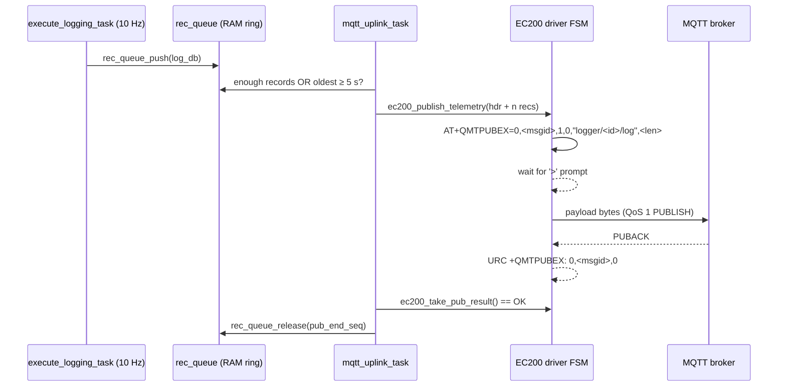

[[RhyGen]]

![[Batching_of_records.excalidraw]]

# MQTT Telemetry Pipeline & Queuing Architecture

## 1. Architecture Overview
The firmware implements an **at-least-once, sequence-tracked** telemetry pipeline that decouples the fixed-rate logging loop from cellular network latency. It spans two files:

| Layer | File | Responsibility |
|---|---|---|
| Application | `App/dg/Src/app_main.c` | Record queue, batching decision, payload format, ACK-driven release |
| Modem driver | `App/common/Src/ec200_driver.c` | AT command sequencing for `AT+QMTPUBEX`, streaming bytes to the modem, matching the PUBACK URC |

Every sampled record is pushed into a fixed-size RAM ring buffer, grouped into a packed binary payload, transmitted over MQTT at **QoS 1** via the EC200 modem, and kept in RAM until the broker returns a `PUBACK`. Transient network drops therefore do not cause gaps in cloud data, provided the outage is shorter than the buffer's capacity (~100 s).

The SD card path is completely independent: every record is also streamed to `0:/LOG_XXXX.BIN` regardless of MQTT state. The SD card is the system of record; MQTT is a best-effort-but-retried live feed.

### Key configuration (`App/dg/Inc/app_config.h`)

| Constant | Value | Meaning |
|---|---|---|
| `LOG_INTERVAL_MS` | 100 | One record every 100 ms → **10 Hz** |
| `MQTT_BATCH_MAX_RECORDS` | 20 | Max records per MQTT publish (≈ 2 s of data) |
| `PUB_INTERVAL_MS` | 5000 | Max age of the oldest queued record before a partial batch is forced out |
| `REC_QUEUE_LEN` | 1024 | Ring buffer length **in records** (not bytes) |
| `EC200_TX_BUF_SIZE` | 1536 | Max payload bytes the driver will accept for one publish |
| `EC200_START_DELAY_MS` | 20000 | Modem FSM and uplink task are not run until 20 s after boot |

### End-to-end flow



## 2. Record Queue (Ring Buffer) Mechanics
The queue is a plain array plus a few counters. It needs **no locking** because it is only touched from the main superloop (`execute_logging_task` pushes, `mqtt_uplink_task` reads/releases); no ISR accesses it.

* **Capacity & Sizing**: `rec_queue` holds up to 1024 entries of type `log_db`. A `log_db` is **64 bytes** (see §7), so the queue occupies exactly 64 KB of RAM. At 10 Hz that is ~102 seconds of offline backlog.
* **State Variables**:
  * `rq_tail`: Array index of the *oldest* record not yet acknowledged.
  * `rq_count`: Number of valid, unacknowledged records in the queue.
  * `rq_tail_seq`: 32-bit sequence number of the record at `rq_tail`. Starts at 0 on every boot.
  * `rq_dropped`: Cumulative count of records evicted by overflow since boot.
* **Head Calculation**: There is no stored "head" index. New data goes to `(rq_tail + rq_count) % REC_QUEUE_LEN`, then `rq_count` is incremented.
* **Sequence Math**: Records do not carry their own sequence numbers. A record at logical offset `i` from the tail implicitly has sequence `rq_tail_seq + i`. The *n*-th record ever logged since boot has sequence *n* (0-based), whether or not it was eventually sent.
* **Wraparound**: A 32-bit sequence at 10 Hz wraps after ~13.6 years, so in practice it never wraps; the signed-difference comparison in `rec_queue_release` would handle it anyway.

## 3. Queue Overflow Policy
If `rq_count == REC_QUEUE_LEN` (prolonged outage, or modem still booting), `rec_queue_push` **never blocks** and never discards the incoming sample. It evicts the oldest entry instead:
1. `rq_tail = (rq_tail + 1) % REC_QUEUE_LEN`
2. `rq_tail_seq++`
3. `rq_count--`
4. `rq_dropped++`

…and then writes the new record at the head as usual (so `rq_count` ends back at 1024).

*Note:* The evicted record is lost to the MQTT pipeline but is still on the SD card.

**Effect on the cloud side:** the next batch will start at a `first_seq` that is higher than the last sequence the server saw, and its `dropped` field will have increased by the same amount. The server can therefore tell exactly which sequence range must be recovered from the SD card.

## 4. Batch Triggering Conditions
`mqtt_uplink_task(current_time)` runs on **every superloop pass** (after the 20 s start delay). There is **at most one** batch in flight at any time (stop-and-wait).

**Step 1: Resolve any in-flight batch.** If `pub_in_flight` is set, the task first polls `ec200_take_pub_result()`:
* `EC200_PUB_OK`: release the acknowledged records (§6) and clear `pub_in_flight`.
* `EC200_PUB_FAIL`, or more than 60 s since `pub_start_time`: clear `pub_in_flight` without releasing anything.
* Otherwise (no result yet): **return**. Nothing else happens this pass.

If the in-flight batch resolved, execution *continues in the same pass*, so the next batch can go out immediately.

**Step 2: Return early** if any of the following hold:
1. **Empty / not ready**: `rq_count == 0`, or `ec200_is_ready()` is false (modem not in `EC200_STATUS_READY`, e.g. still connecting, reconnecting, or busy).
2. **Wait condition**: `rq_count < MQTT_BATCH_MAX_RECORDS` **and** `current_time - rec_queue[rq_tail].mech_db.timestamp < PUB_INTERVAL_MS`.
   The age is measured from the **oldest record's own logging timestamp**, not from the last publish. Unsigned subtraction keeps this correct across the 49.7-day `HAL_GetTick()` rollover.

Otherwise, proceed to packet assembly.

### What this means in practice
| Situation | Behaviour |
|---|---|
| Steady state, 10 Hz, link healthy | 20 records accumulate in ~2 s → a **full batch every ~2 s**. The 5 s timer never fires. |
| Logging slowed or a partial batch left over | Oldest record hits 5 s → partial batch (< 20 records) is sent. |
| Recovering from an outage / after boot | Queue holds a backlog, oldest record is already old → **full batches back-to-back**, one per PUBACK round trip, until drained. |
| Boot | ~200 records are queued during the 20 s start delay, plus however long MQTT connect takes; these drain first as full batches. |

## 5. Binary Packet Assembly & Transmission

### 5.1 Assembly (`app_main.c`)
1. **Batch Sizing**: `n = min(rq_count, MQTT_BATCH_MAX_RECORDS)`.
2. **Header Construction**: `mqtt_batch_hdr_t` is packed, 16 bytes, little-endian. Layout below.

| Offset | Field       | Type | Value                                                     |
| -----: | ----------- | ---- | --------------------------------------------------------- |
|      0 | `device_id` | u32  | CRC-32 of the MCU's 96-bit factory UID                    |
|      4 | `fmt_ver`   | u8   | `MQTT_FMT_VERSION` (= 1)                                  |
|      5 | `rec_size`  | u8   | `sizeof(log_db)` (= 64), lets the server decode old layouts |
|      6 | `n_recs`    | u16  | Records in this payload (1..20)                           |
|      8 | `first_seq` | u32  | `rq_tail_seq`, the sequence number of record 0            |
|     12 | `dropped`   | u32  | `rq_dropped` at the time the batch was built              |

3. **Memory Packing**: The header is `memcpy`'d into the static `pub_buf`, followed by the `n` records copied out of the ring (indices wrap with `% REC_QUEUE_LEN`, so a batch may straddle the end of the array). The records are byte-for-byte what is written to the SD card.
   * Full batch size: `16 + 20 × 64 = 1296 bytes`.
   * *Safety Net:* `_Static_assert(sizeof(hdr) + MQTT_BATCH_MAX_RECORDS * sizeof(log_db) <= EC200_TX_BUF_SIZE)`. Raising the batch size past 23 records breaks the build instead of silently truncating.
   * Because the payload is a **copy**, later overflow evictions in the ring can't corrupt a batch that's already in flight.
4. **Topic**: `logger/<DEVICE_ID as 8 hex digits>/log`. The MQTT client ID is `LOG_<DEVICE_ID>`.
5. **Hand-off**: `ec200_publish_telemetry()` is called. A `true` return only means *the driver accepted the job* (modem was READY and length fits), not that anything was delivered. On `true` the app sets `pub_in_flight = true`, `pub_end_seq = rq_tail_seq + n`, and `pub_start_time = current_time`.

### 5.2 Transmission (`ec200_driver.c`)
`ec200_publish_telemetry()` copies the payload into the driver's own `tx_buf`, increments the QoS 1 packet ID `pub_msgid` (skipping 0, which is invalid for QoS 1), sets status to `BUSY`, and sends:

```
AT+QMTPUBEX=0,<msgid>,1,0,"logger/<id>/log",<len>
             │   │    │ │                       └ payload length in bytes
             │   │    │ └ retain = 0
             │   │    └ QoS = 1
             │   └ packet ID
             └ MQTT client index 0
```

Because the length is declared up front, the payload is sent as raw binary: no Ctrl+Z terminator and no escaping. The FSM then steps through:

| State | Waits for | On success | Failure → `EC200_PUB_FAIL` |
|---|---|---|---|
| `EC200_MTPublish` | `>` prompt (detected byte-by-byte in the RX callback) | → `MTPub_Send` | `ERROR` response, or 3 s timeout |
| `EC200_MTPub_Send` | UART to accept all `tx_len` bytes. The TX FIFO is smaller than a batch, so it is fed across several passes using `tx_off`. | → `MTPub_Ack` | 3 s timeout |
| `EC200_MTPub_Ack` | URC `+QMTPUBEX: 0,<msgid>,<result>` with **matching msgid** | result `0` (PUBACK) → `EC200_PUB_OK`, status back to `READY` | `ERROR`, result `2` (modem gave up), or 30 s timeout |

* Result `1` means the modem is retransmitting the PUBLISH itself (MQTT DUP); the FSM keeps waiting.
* A URC with a stale msgid (e.g. a late ACK from an earlier timed-out attempt) is ignored.
* **Link loss** (`+QMTSTAT` URC) in any of these states calls `publish_link_lost()`. It reports `FAIL` but **leaves status `BUSY`**, so `ec200_is_ready()` stays false and the app can't publish until `Idle_Online` has run the full reconnect (`QIDEACT` → APN → `QIACT` → `QMTOPEN` → `QMTCONN`) and set `READY` again.

## 6. Acknowledgment & Sequence-Based Release
* **Failure / Timeout**: `pub_in_flight` is cleared and the queue is untouched. The next attempt is **rebuilt from the current tail**, so it is not necessarily byte-identical to the failed one:
  * it gets a new MQTT packet ID;
  * if the failed batch was partial, the retry may contain more records (up to 20);
  * if overflow evicted records meanwhile, it starts at a higher `first_seq`.
  The app's 60 s timeout is only a backstop; the driver's own 30 s `MTPub_Ack` timeout normally fires first.
* **Success (PUBACK)**: `rec_queue_release(pub_end_seq)` pops records while `(int32_t)(pub_end_seq - rq_tail_seq) > 0`, advancing `rq_tail`, incrementing `rq_tail_seq`, and decrementing `rq_count`.
  * *Why sequence bounds instead of popping `n`?* If the queue overflowed while the batch was in transit, some of the sent records were already evicted and `rq_tail_seq` has moved forward. Popping `n` would then delete brand-new, never-sent records. The sequence bound pops only the acknowledged survivors, and pops nothing if all of them were evicted.

## 7. Record Layout (`log_db`, 64 bytes)
Defined in `App/dg/Inc/app_state.h`. The outer structs are `#pragma pack(1)`, but the inner `app_gen_*_state_t` structs are **not** packed, so they carry compiler padding. Decoders must use these exact offsets (little-endian):

| Offset | Size | Field |
|---|---|---|
| 0 | 4 | `elec_db.timestamp` (ms since boot) |
| 4 | 32 | `elec_db.gen_elec_params`: 8 × float32: active power R/Y/B/total, reactive power R/Y/B/total |
| 36 | 1 | `elec_db.gen_elec_params.link_error` |
| 37 | 3 | *padding inside `app_gen_elec_state_t`* |
| 40 | 1 | `elec_db.link_error` (copy of the above) |
| 41 | 4 | `mech_db.timestamp` (ms since boot; same value as `elec_db.timestamp`) |
| 45 | 4 | `engine_hours` (raw SPN 247) |
| 49 | 2 | `engine_speed` (raw SPN 190) |
| 51 | 2 | `oil_temp` (raw SPN 175) |
| 53 | 2 | `fuel_rate` (raw SPN 183) |
| 55 | 1 each | `actual_torque`, `engine_load`, `apps`, `coolant_temp`, `fuel_press`, `oil_press` (55–60) |
| 61 | 1 | `mil_active` |
| 62 | 2 | `reserved_padding` |

Any change to these structs changes `sizeof(log_db)`. That must be accompanied by a bump of `MQTT_FMT_VERSION`, and `rec_size` will change automatically.

## 8. Delivery Guarantees & Server-Side Handling
* **At-least-once, not exactly-once.** Duplicates are possible, e.g. when the broker received the batch but the PUBACK/URC was lost or arrived after the 30 s timeout. The app then resends the same sequence range. **The server must dedupe on `(device_id, first_seq + i)`.**
* **Gap detection.** For each device, the server should track the next expected sequence. If `first_seq` jumps ahead, the missing range was evicted by overflow (cross-check with the increase in `dropped`) and must be recovered from the SD card.
* **Reboot detection.** `rq_tail_seq` and `rq_dropped` reset to 0 on boot, and the RAM queue is lost. A `first_seq` that goes *backwards* signals a reboot, and anything that was queued but un-ACKed at reset is missing from MQTT (still on SD). There is currently no boot counter or boot ID in the header to make this unambiguous.
* **Timestamps are relative.** `timestamp` is `HAL_GetTick()` milliseconds since boot, not wall-clock time. The server must anchor records to receive time, or the device needs an RTC/network time source.

## 9. Throughput & Limits
* **Stop-and-wait bound.** Only one batch is in flight at a time, so sustained throughput = `20 records / (publish round-trip time)`. The device produces 20 records every 2 s, so **the average round trip (AT command → `>` → UART transfer → PUBACK) must stay under ~2 s**, or the backlog grows and eventually overflows. Draining a backlog requires round trips well under 2 s.
* **Outage tolerance.** About 102 s of backlog (1024 records). Longer outages lose the oldest records from MQTT, tracked in `dropped`.
* **Batch size ceiling.** Limited by `EC200_TX_BUF_SIZE` (1536 B): at most 23 records per batch with the current 64 B record and 16 B header. Raising it also requires the modem's `AT+QMTPUBEX` length limit and RAM for both `pub_buf` and `tx_buf` (the payload is held twice).

## 10. Code References
* Config: `App/dg/Inc/app_config.h`
* Record struct: `App/dg/Inc/app_state.h` (`log_db`)
* Queue, batching, release: `App/dg/Src/app_main.c`: `rec_queue_push`, `rec_queue_release`, `mqtt_uplink_task`, `mqtt_batch_hdr_t`
* Modem publish path: `App/common/Src/ec200_driver.c`: `ec200_publish_telemetry`, `ec200_take_pub_result`, states `EC200_MTPublish` / `EC200_MTPub_Send` / `EC200_MTPub_Ack`
---
Okay, so a bit of software architecture for you lot in this post. 

I am producing logs at a rate of 10Hz (10 logs a second). Each log is 64B in size, meaning each second produces 640 bytes of data. I wish to batch 2 seconds' worth of logs into a single packet and send it over MQTT via a 4G module. Here is how I am handling it on my microcontroller (MCU).

I have set up a Single Producer, Single Consumer (SPSC) circular buffer. It's an array of the same data type as my logging structure, sized to hold 100 seconds of data—meaning 1024 objects in it. Why so large? Because 4G modules can have insane levels of latency, and a 100-second buffer acts as a massive shock absorber in RAM. The downside is that I am consuming a hefty 64KB of RAM, but hey, if my MCU doesn't have an issue with it, neither should you!

To manage this, I am not calculating a dedicated "head" for the buffer. Instead, I just track a `tail` index and the number of objects queued for transmission, called `count`. The logical head is simply calculated on the fly as `(tail + count) % size_of_the_buffer`. We write a new log at this calculated head, and increment the count once we do.

There is a dedicated transmission task that continuously monitors the count of items in the buffer. Once it hits 20 (our 2-second batch), we start constructing a header for the MQTT packet. Among other things, this header tracks the number of records being written to the packet, the sequence number of the first log in the batch, and the number of "dropped" logs. (These dropped logs are only lost to our MQTT pipeline if the RAM buffer overflows; they are still safely preserved by an SD card routine that runs completely independently.)

Next, we copy the header into a publish buffer, followed by copying the queued logs by value into that same buffer, one log at a time in a loop. We also maintain a boolean variable called `pub_in_flight`, which indicates the status of an active published packet, and `pub_end_seq`, which is set to the `tail_sequence` plus the number of actually transmitted logs. Once the packet is ready and the publish function is called, `pub_in_flight` is set to true and we move on.

In the next iteration of the super-loop, we check the status of `pub_in_flight`. If the MQTT broker has acknowledged the publish, we drain the queue up to the position of `pub_end_seq`. We update the tail via a wrap-around guard (modulo the buffer size) to force it to stay within the limits of the buffer, decrement our `count` by the number of successful logs, and advance our `tail_sequence` to reflect the new oldest record in the queue.